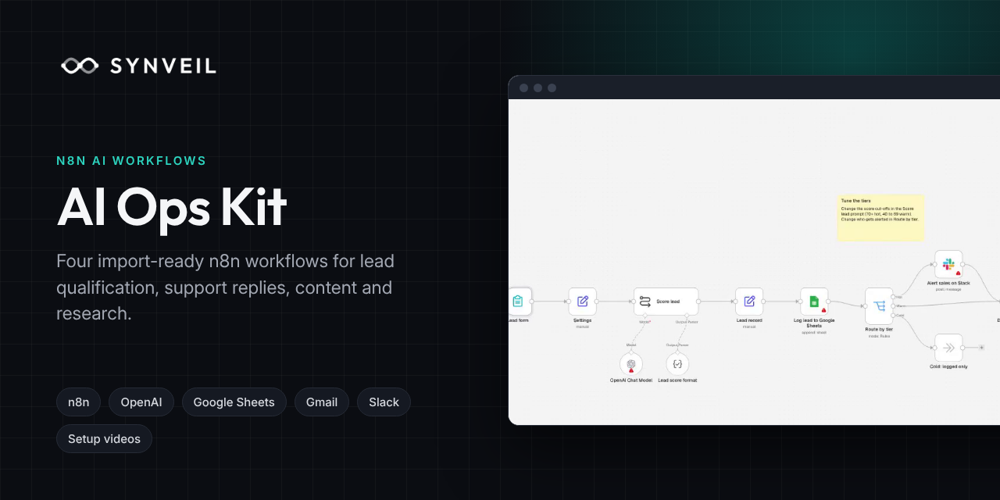
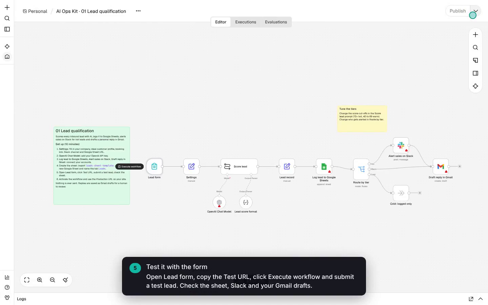
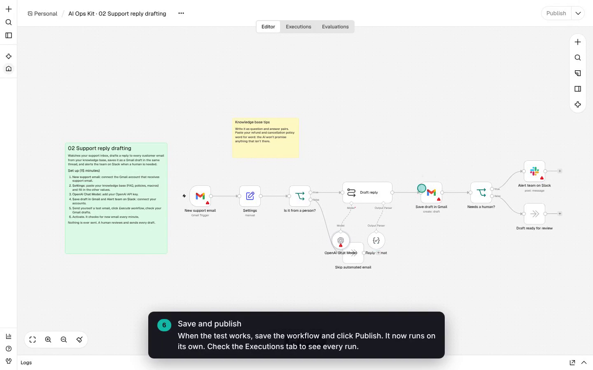
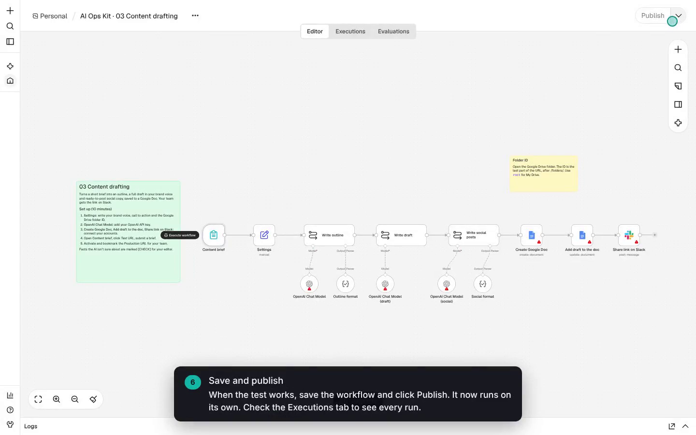
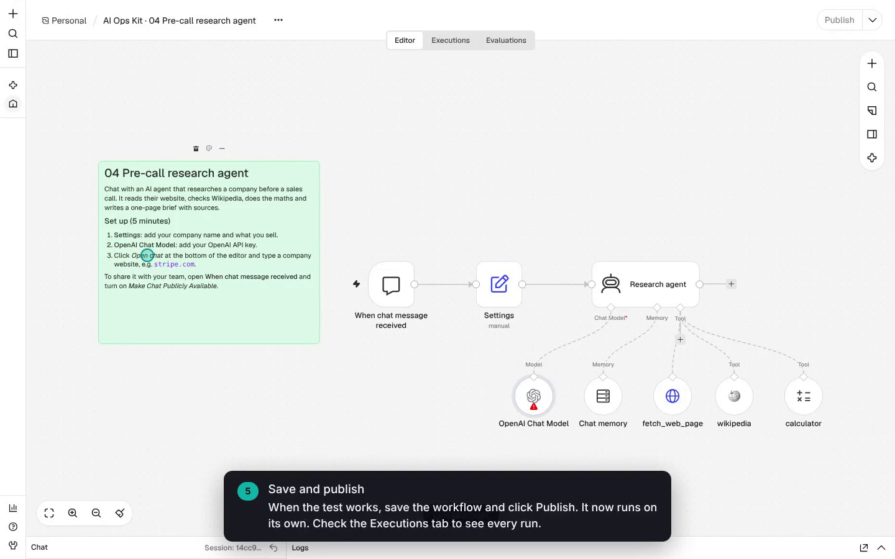

# AI Ops Kit

**Four n8n workflows for lead qualification, support replies, content and research.** Import them, add your keys, and they run.

**$299, one-time** · [**Buy on Whop →**](https://whop.com/synveil/ai-ops-kit-f5/) · [All Synveil kits](https://synveil.whop.site/)

> This repo is the public page for the AI Ops Kit. The workflow files, videos and prompts are delivered when you buy. They aren't in this repo.

## The workflows

| | Workflow | What it does |
|---|---|---|
| 01 | **Lead qualification** | Scores each new lead with AI, logs it to Google Sheets, alerts sales on Slack for hot leads and drafts a personal reply in Gmail |
| 02 | **Support reply drafting** | Drafts replies to support email from your own knowledge base and flags anything that needs a human |
| 03 | **Content drafting** | Turns a brief into an outline, a draft and social posts, saved to Google Docs |
| 04 | **Pre-call research agent** | An AI agent that researches a company before a call and writes a sourced brief |

Email replies are saved as Gmail drafts for a person to review, so nothing goes to a customer automatically.

## What's inside

- Four import-ready n8n workflow files, plus a lead sheet template
- A captioned setup video for each workflow
- A prompt library: every prompt in the workflows, agent templates and 12 everyday prompts (Markdown and PDF)
- A setup guide (PDF)

All four workflows were imported and run end to end on n8n 2.46.

## Screenshots

Frames from the setup videos included in the kit.

| 01 Lead qualification | 02 Support reply drafting |
|---|---|
|  |  |
| **03 Content drafting** | **04 Pre-call research agent** |
|  |  |

## What you need

- n8n, either n8n Cloud or self-hosted
- An OpenAI API key
- Google (Sheets, Gmail, Docs) and Slack for workflows 1 to 3

## How you get it

1. Buy on [Whop](https://whop.com/synveil/ai-ops-kit-f5/). Access is instant.
2. Download the zip and open the setup guide.
3. In n8n, create a workflow, open the **…** menu and choose **Import from file**.
4. Connect your accounts, watch the matching video, and run a test.

Also in [Synveil Complete](https://whop.com/synveil/synveil-complete/), the bundle of all five Synveil kits.
